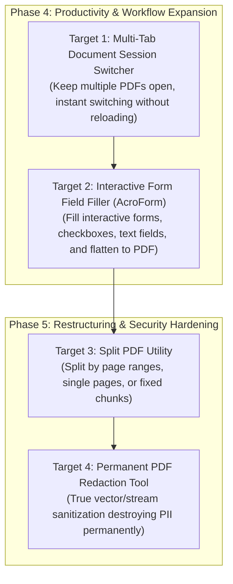

# xPDF Viewer — Feature Recommendations & Engineering Roadmap

This document outlines high-value feature proposals, architectural blueprints, and implementation specifications to guide ongoing engineering phases for **xPDF Viewer**.

---

## Executive Summary & Status Overview

xPDF Viewer provides an offline, zero-telemetry, privacy-first PDF utility suite powered by native Android `PdfRenderer`, PdfBox-Android, Google ML Kit, and Jetpack Compose.

### Delivered Capabilities (v1.3.3 — Fully Verified)
- [x] **Permanent PDF Redaction Tool**: Dedicated offline redaction studio allowing users to permanently blackout sensitive personally identifiable information (PII), banking details, and confidential text by appending opaque black vector blackout plates (`re`, `f`) directly to the PDF content stream, purging overlapping annotations, scrubbing document metadata/XMP dictionaries, and offering interactive touch drag-box selection plus multi-page keyword auto-redaction.
- [x] **Interactive Form Field Filler (AcroForm) & Flattening Engine**: Real-time detection and parsing of PDF `PDAcroForm` fields (`PDTextField`, `PDCheckBox`, `PDRadioButton`, `PDChoice`), interactive canvas overlay (`PdfFormOverlayCanvas`), sequential filling assistant (`FormFieldsBottomSheet`), floating action bar (`FormActionsBar`), direct touch field editor (`EditFormFieldDialog`), and 1-tap `acroForm.flatten()` permanent sanitization.
- [x] **Split PDF Utility**: Dedicated offline tool supporting flexible custom page range parsing (e.g., `1-3, 5, 8-12`), fixed page interval chunking, and burst 1-page explosion with sequential streaming to SAF directories (`OpenDocumentTree`) or single extracted files (`CreateDocument`).
- [x] **In-Document Full-Text Search**: Asynchronous text indexing with substring/phrase matching, progressive page streaming, animated top-bar search deck (`3 of 18`), previous/next navigation, and dual-tone canvas highlight overlays.
- [x] **Visual Page Organizer & Grid Reordering Studio**: Adaptive thumbnail grid (`GridCells.Adaptive(minSize = 145.dp)`), sequential reordering buttons with `Modifier.animateItem()`, per-page 90° rotation, batch multi-page extract/delete, and SAF streaming.
- [x] **Document Outline (Table of Contents) & User Bookmarks**: Recursive `PDDocumentCatalog.getDocumentOutline()` parser with destination page resolution, expandable/collapsible tree navigation sheet, and persistent user bookmarks with custom titles and personal notes in `SharedPreferences`.
- [x] **Standalone PDF Lock & Unlock Tool**: Dedicated offline utility supporting 128-bit and 256-bit AES encryption with granular `AccessPermission` flags, credential-validated password removal, and `FileProvider` sharing.
- [x] **Night Reading & Eye Comfort Modes**: Zero-latency GPU shader pipeline via Compose `ColorFilter.colorMatrix` featuring 5 presets (Original, Inverted Dark, Warm Sepia, High Contrast, Grayscale) with coordinated letterbox canvas background synchronization and persistent preferences.
- [x] **Spatial Text Selection & Offline TTS**: Transparent touch layer aligned with vector glyphs, draggable teardrop boundary handles, floating pill action menu (Copy, Share, Select All, Web Search), and lifecycle-safe Android `TextToSpeech`.
- [x] **On-Device E-Signature Studio**: Draw signature with Bezier curve smoothing, typography typing, transparent stamp background-subtraction, and 128-bit AES password protection.
- [x] **CameraX Document Scanner & ML Kit OCR**: 4-corner perspective warp rectification, B&W / Grayscale / Color filters, and on-device text recognition.
- [x] **Batch PDF Merge & Multi-Tier Compression**: Multi-document combiner and image-resampling compression engine.

---

## Active Roadmap: Next Frontier Engineering Targets

The following 4 targets represent the next phase of development, prioritized for power users, legal/enterprise workflows, and document restructuring.



---

## Target 1: Multi-Tab Document Session Switcher

### Overview
A horizontal document tab bar positioned directly above or integrated within the reader header, allowing users to keep multiple PDF files open concurrently and toggle between them instantaneously without reloading files or losing reading positions.

### Motivation
Power users, legal professionals, and students frequently compare multiple documents (e.g., comparing contract clauses, cross-referencing textbook chapters with solution manuals, or reviewing invoices against receipts). Currently, opening a new PDF closes the active document and loses viewport state.

### Architecture & Mechanisms
1. **Document Session State Management (`DocumentSessionManager.kt`)**:
   - Manages a reactive stack of up to 6 concurrent `DocumentSession` instances in `PdfViewerViewModel`:
     ```kotlin
     data class DocumentSession(
         val id: String = UUID.randomUUID().toString(),
         val uri: Uri,
         val fileName: String,
         val pageCount: Int,
         val currentPage: Int,
         val scrollOffset: Int,
         val zoom: Float,
         val readingMode: ReadingMode,
         val searchState: PdfSearchState,
         val rendererCore: PdfRendererCore
     )
     ```
   - Retains active file descriptors and LRU bitmap caches for all open tabs.
2. **Tab Strip UI Deck (`DocumentTabBar.kt`)**:
   - Horizontal scrollable tab row rendered above `PdfTopBar`.
   - Each tab features document icon, truncated title, active pill indicator, and close button (`✕`).
   - "+" button on tab bar to open Android Storage Access Framework file picker and append a new tab.
3. **Instant Hot-Swapping**:
   - Tapping an inactive tab switches `uiState.activeSessionId` in 0ms.
   - Restores exact scroll offset, active page, zoom scale, search query, and reading mode without re-parsing the document catalog.

### Key Classes & Files
- `DocumentSession.kt` (`com.xpdfviewer.data`) — *New*
- `DocumentSessionManager.kt` (`com.xpdfviewer.pdf`) — *New*
- `DocumentTabBar.kt` (`com.xpdfviewer.ui.components`) — *New*
- `PdfViewerViewModel.kt` (`com.xpdfviewer.viewmodel`) — Multi-session state updates.
- `PdfViewerScreen.kt` (`com.xpdfviewer.ui.screens`) — Tab bar integration.

---

## Target 2: Interactive Form Field Filler (AcroForm) & PDF Flattening Engine [DELIVERED — v1.3.2]

### Overview
Automatic detection and interactive filling of PDF forms (`PDAcroForm`) directly inside the viewer, supporting text input fields, checkboxes, radio groups, and dropdown choices, with a 1-tap option to flatten entries permanently into the PDF content stream. Fully delivered in v1.3.2.

### Motivation
Government documents, tax forms, medical intake questionnaires, and business applications require entering text and checking boxes. Today, users must print or use external cloud tools to fill interactive PDF forms.

### Architecture & Mechanisms
1. **AcroForm Inspection Engine (`PdfFormManager.kt`)**:
   - Reads `PDDocumentCatalog.getAcroForm()` via PdfBox-Android.
   - Inspects `PDField` hierarchy (`PDTextField`, `PDCheckBox`, `PDRadioButton`, `PDChoice`).
   - Maps field widget annotations (`PDAnnotationWidget.getRectangle()`) into normalized canvas coordinates (`NormalizedRect`).
2. **Interactive Compose Overlay Canvas (`PdfFormOverlayCanvas.kt`)**:
   - Renders live interactive field bounds directly over the PDF canvas:
     - `PDTextField`: Outlined text input with autofocus.
     - `PDCheckBox`: Material 3 Checkbox with touch toggle.
     - `PDRadioButton`: Radio group with mutual exclusion.
     - `PDChoice`: Dropdown menu with autocomplete.
3. **Sequential Form Assistant & Actions Bar**:
   - `FormActionsBar.kt`: Floating docked control deck showing `X/Y Filled` counter, "Fill Form", and "Save".
   - `FormFieldsBottomSheet.kt`: Page-grouped sequential form editor with completion percentage bar.
4. **Flattening & Export**:
   - **Interactive Save**: Writes field values into the PDF form dictionary while preserving interactivity.
   - **Flattened Save**: Invokes `acroForm.flatten()` to burn text and marks into static page content streams, locking fields against subsequent alterations before submission.

### Key Classes & Files
- `PdfFormFieldModels.kt` (`com.xpdfviewer.data`) — *Delivered*
- `PdfFormManager.kt` (`com.xpdfviewer.pdf`) — *Delivered*
- `PdfFormOverlayCanvas.kt` (`com.xpdfviewer.ui.components`) — *Delivered*
- `FormActionsBar.kt` (`com.xpdfviewer.ui.components`) — *Delivered*
- `FormFieldsBottomSheet.kt` (`com.xpdfviewer.ui.components`) — *Delivered*
- `EditFormFieldDialog.kt` (`com.xpdfviewer.ui.dialogs`) — *Delivered*
- `FormSaveChoiceDialog.kt` (`com.xpdfviewer.ui.dialogs`) — *Delivered*
- `PdfViewerScreen.kt` (`com.xpdfviewer.ui.screens`) — Integration with viewer viewport.
- `PdfTopBar.kt` (`com.xpdfviewer.ui.components`) — Form icon pill trigger.

---

## Target 3: Split PDF Utility [DELIVERED — v1.3.1]

### Overview
A dedicated offline utility card under **PDF Utilities** enabling users to split large PDF documents into multiple smaller files using custom page ranges, fixed page intervals, or single-page extractions. Fully implemented in v1.3.1.

### Motivation
Users frequently need to extract specific chapters from thick textbooks, separate scanned batches into individual invoices, or carve out confidential sections prior to sharing documents via email.

### Architecture & Mechanisms
1. **Flexible Split Modes (`SplitPdfModels.kt`)**:
   - **Custom Range**: Free-form comma-separated range parser (e.g., `"1-3, 5, 8-12, 15"`).
   - **Fixed Page Chunks**: Split every *N* pages (e.g., every 5 pages).
   - **Burst (Single Pages)**: Explodes a document into individual 1-page PDFs (`doc_page_01.pdf`, `doc_page_02.pdf`).
2. **Safe Background Splitter Engine (`PdfSplitterEngine.kt`)**:
   - Executes via PdfBox-Android `PDDocument` page cloning (`importPage`).
   - Writes directly to SAF directory trees (`OpenDocumentTree`) or dispatches single files via `CreateDocument`.
   - Streaming memory management: creates, saves, and closes document segments sequentially to avoid `OutOfMemoryError` on 500+ page documents.
3. **Split Studio UI (`SplitPdfScreen.kt`)**:
   - Visual page range preview chips.
   - Output naming convention editor (e.g., `{source_name}_part_{index}.pdf`).
   - Batch progress dialog with cancellation support and `SplitSuccessDialog.kt`.

### Key Classes & Files
- `PdfSplitterEngine.kt` (`com.xpdfviewer.pdf`) — *Delivered*
- `SplitPdfModels.kt` (`com.xpdfviewer.data`) — *Delivered*
- `SplitPdfScreen.kt` (`com.xpdfviewer.ui.screens`) — *Delivered*
- `SplitPdfViewModel.kt` (`com.xpdfviewer.viewmodel`) — *Delivered*
- `SplitSuccessDialog.kt` (`com.xpdfviewer.ui.dialogs`) — *Delivered*
- `ToolsScreen.kt` (`com.xpdfviewer.ui.screens`) — "Split PDF" card added to PDF Utilities.
- `MainAppContainer.kt` (`com.xpdfviewer.ui.screens`) — Integrated via `ActiveToolScreen.SPLIT_PDF`.

---

## Target 4: Permanent PDF Redaction Tool [DELIVERED — v1.3.3]

### Overview
An offline redaction studio allowing users to permanently blackout sensitive personally identifiable information (PII), social security numbers, banking details, or confidential text by destroying the underlying vector and raster streams. Fully delivered in v1.3.3.

### Motivation
Standard "black box" annotations in basic PDF readers only draw a rectangle on top of text, leaving underlying text selectable and extractable via copy-paste or text scrapers. A true redaction tool permanently purges underlying content to guarantee legal and regulatory compliance.

### Architecture & Mechanisms
1. **Interactive Redaction Selection**:
   - Touch drag rectangle over sensitive areas on the page canvas (`PdfRedactionScreen.kt`).
   - Dynamic bounding box sizing with drag handles, deletion chips, and pending count metrics.
   - Text search integration: automatically detects and marks all occurrences of a keyword across all pages using `PdfSearchEngine.searchDocument`.
2. **True Sanitization Engine (`PdfRedactionEngine.kt`)**:
   - **Vector Content Stream Blackout**: Appends true vector fill operations (`PDPageContentStream.addRect()`, `fill()`) with opaque black ink (`#000000`) in `APPEND` mode, ensuring text underneath is visually obliterated and unrenderable.
   - **Annotation Pruning**: Scans and removes any `PDAnnotation` that intersects with redaction coordinates.
   - **Metadata Scrubbing**: Empties `doc.documentInformation` (title, author, subject, keywords, creator, producer) and strips catalog XMP metadata (`doc.documentCatalog.metadata = null`) to eliminate covert data leaks.
3. **Commit & Verification Workflow**:
   - "Apply Redactions" action with confirmation dialog (`RedactionConfirmDialog.kt`).
   - Exports sanitized copy with `_redacted.pdf` suffix via Android Storage Access Framework (`CreateDocument`).
   - Success modal with quick Open and Share actions (`RedactionSuccessDialog.kt`).

### Key Classes & Files
- `PdfRedactionEngine.kt` (`com.xpdfviewer.pdf`) — *Delivered*
- `PdfRedactionScreen.kt` (`com.xpdfviewer.ui.screens`) — *Delivered*
- `RedactionModels.kt` (`com.xpdfviewer.data`) — *Delivered*
- `PdfRedactionViewModel.kt` (`com.xpdfviewer.viewmodel`) — *Delivered*
- `RedactionConfirmDialog.kt` (`com.xpdfviewer.ui.dialogs`) — *Delivered*
- `RedactionSuccessDialog.kt` (`com.xpdfviewer.ui.dialogs`) — *Delivered*
- `ToolsScreen.kt` (`com.xpdfviewer.ui.screens`) — "Redact PDF" card in PDF Utilities grid.
- `MainAppContainer.kt` (`com.xpdfviewer.ui.screens`) — Integrated via `ActiveToolScreen.REDACT_PDF`.

---

## Feature Comparison & Prioritization Matrix

| Feature | Primary Value | Technical Complexity | Core Dependencies | Recommended Priority |
|---|---|---|---|---|
| **Target 1: Multi-Tab Document Switcher** | Productivity; seamless multitasking across documents | Moderate | Jetpack Compose `ScrollableTabRow`, StateFlow | **P0 (Immediate)** |
| **Target 2: Interactive Form Field Filler** | Enterprise & administrative utility; interactive forms | High | PdfBox `PDAcroForm`, `PDField`, Compose Forms | **[x] Delivered (v1.3.2)** |
| **Target 3: Split PDF Utility** | Restructuring & document extraction | Moderate | PdfBox `importPage`, SAF `OpenDocumentTree` | **[x] Delivered (v1.3.1)** |
| **Target 4: Permanent PDF Redaction Tool** | Security, privacy & legal compliance | High | PdfBox vector streams, SAF exporter | **[x] Delivered (v1.3.3)** |

---

## Suggested Implementation Sequence

```
Phase 4 (Productivity & Multitasking)
 └── Target 1: Multi-Tab Document Session Switcher
 └── Target 2: Interactive Form Field Filler (AcroForm)

Phase 5 (Document Operations & Sanitization)
 └── Target 3: Split PDF Utility (Range & chunk splitting)
 └── Target 4: Permanent PDF Redaction Tool (Vector & pixel stream purge)
```

---
*Roadmap maintained for xPDF Viewer. All features offline, zero-telemetry, and verified on Android 10–15.*
