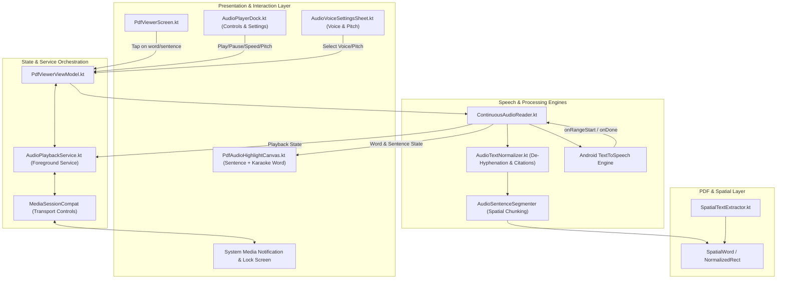
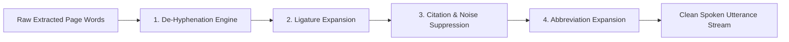
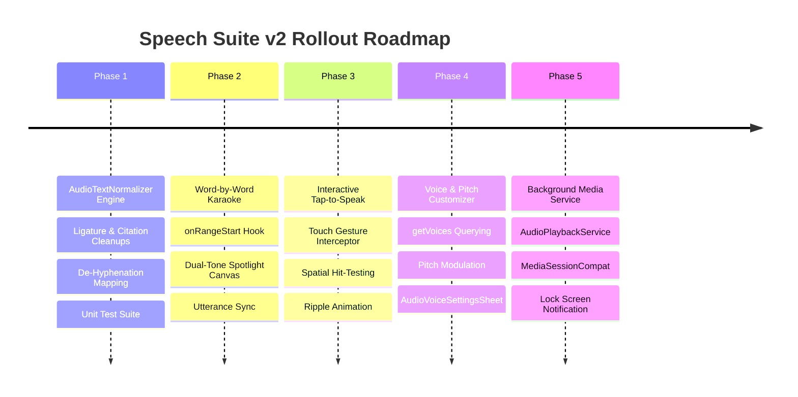

# Master Implementation Plan: Continuous Speech & Audio Suite v2

This document specifies the technical architecture, data models, component interactions, and implementation plan for the **Speech Suite v2** expansion in **xPDF Viewer**.

---

## 1. Executive Summary & Capabilities

Building upon the v1.3.4 Continuous Audio Reader baseline, Speech Suite v2 transforms document listening into an intelligent, immersion-grade audiobook system:

| Feature | Primary Goal | Core Technology |
|---|---|---|
| **1. Word-by-Word "Karaoke" Tracking** | Precise visual word tracking in real-time | `UtteranceProgressListener.onRangeStart()`, Character-to-Word offset mapping, dual-tone highlight canvas |
| **2. Text Normalizer & De-Hyphenation** | Natural, uninterrupted acoustic pronunciation | Regex de-hyphenation, ligature expansion, citation suppression (`[1]`, `(Smith, 2020)`), abbreviation expansion |
| **3. Background Media Service & Lock Screen** | Continuous playback when screen is off or app is backgrounded | Android `ForegroundService`, `MediaSessionCompat`, `NotificationCompat.MediaStyle`, Lock Screen Controls |
| **4. Interactive "Tap-to-Speak"** | Direct random-access seeking on document page | Touch coordinate hit-testing against `AudioSentence.wordBounds`, instant utterance interruption and jump |
| **5. Voice Engine & Pitch Customizer** | Personalized voice timbre, pitch, and accent | `TextToSpeech.getVoices()`, `setPitch()`, offline voice filter, preferences persistence |

---

## 2. Architecture & Data Flow Diagram



---

## 3. Detailed Feature Specifications

### Feature 1: Word-by-Word "Karaoke" Tracking (`onRangeStart`)

#### 1.1 Technical Problem
Currently, `PdfAudioHighlightCanvas.kt` renders an amber bounding box encompassing the entire active sentence. For complex multi-line sentences, users cannot pinpoint the exact word currently being spoken, diminishing the immersion and reading-assistance value.

#### 1.2 Implementation Mechanism
1. **Utterance Progress Listener Hook**:
   - In Android 8.0+ (API 26+), `UtteranceProgressListener` provides:
     ```kotlin
     override fun onRangeStart(utteranceId: String?, start: Int, end: Int, frame: Int)
     ```
   - `start` and `end` represent character offsets within the sentence text passed to `TextToSpeech.speak()`.

2. **Character Offset Mapping**:
   - Each `AudioSentence` records the character range `[charStart, charEnd]` for every constituent word.
   - When `onRangeStart(start, end)` fires:
     - Binary search or locate the `SpatialWord` index where `word.charStart <= start && word.charEnd >= end`.
     - Emit the active `SpatialWord` bounding box (`NormalizedRect`) into `AudioReaderUiState.activeWordBounds`.

3. **Dual-Tone Visual Rendering in `PdfAudioHighlightCanvas.kt`**:
   - **Sentence Level**: Translucent amber/gold background (`Color(0xFFF59E0B).copy(alpha = 0.18f)`) with soft rounded corners (`4.dp`).
   - **Active Word Level**: High-contrast, solid amber pill (`Color(0xFFD97706).copy(alpha = 0.45f)`) with a crisp outline stroke (`1.5.dp`, `Color(0xFFB45309)`), instantly tracking the speaker's vocal progression.

---

### Feature 2: PDF De-Hyphenation & Text Normalizer Engine

#### 2.1 Technical Problem
PDF text layout engines break long words at line ends with hyphens (`-`). When raw text is extracted:
- `"in- "` on line 1 followed by `"formation"` on line 2 becomes `"in- formation"`.
- TTS engines pronounce this as *"in hyphen formation"*.
- Academic papers and legal contracts also contain dense bracketed citations (`[12]`, `[14-16]`), parentheticals (`(Smith et al., 2021)`), raw URLs, and font ligatures (`fi`, `fl`, `œ`), which cause jarring, repetitive audio stutter.

#### 2.2 Normalization Pipeline (`AudioTextNormalizer.kt`)



1. **De-Hyphenation Algorithm**:
   - Detects word pairs across line breaks ending with `-` or `—`.
   - Merges token text while maintaining character mapping back to the two distinct visual bounding boxes.
2. **Ligature Expansion Table**:
   - `fi` $\to$ `fi`
   - `fl` $\to$ `fl`
   - `ff` $\to$ `ff`
   - `ffi` $\to$ `ffi`
   - `ffl` $\to$ `ffl`
   - `st` $\to$ `st`
   - `œ` $\to$ `oe`
   - `æ` $\to$ `ae`
3. **Citation & Noise Filtering**:
   - Prunes numeric bracketed citations (`Regex("""\[\d+(?:[-–,]\s*\d+)*\]""")`).
   - Prunes academic author-year parentheticals (`Regex("""\([A-Z][a-zA-Z\s]+(?:et al\.)?,\s*\d{4}[a-z]?\)""")`).
   - Replaces long URLs (`https://...`) with *"web link"*.
4. **Abbreviation & Symbol Pronunciation**:
   - `e.g.` $\to$ *"for example"*
   - `i.e.` $\to$ *"that is"*
   - `et al.` $\to$ *"and others"*
   - `etc.` $\to$ *"etcetera"*
   - `Fig.` / `Figs.` $\to$ *"Figure"* / *"Figures"*
   - `Dr.` $\to$ *"Doctor"*
   - `vs.` $\to$ *"versus"*
   - `%` $\to$ *"percent"*
   - `&` $\to$ *"and"*

---

### Feature 3: Background Audio Service & Lock Screen Media Deck

#### 3.1 Technical Problem
Currently, `ContinuousAudioReader` runs in the ViewModel scope. When a user turns off their phone screen, locks the device, or switches to another app, the Android OS suspends the activity coroutines, abruptly stopping playback.

#### 3.2 Service Architecture (`AudioPlaybackService.kt`)
1. **Android Foreground Service**:
   - Declared in `AndroidManifest.xml` with `foregroundServiceType="mediaPlayback"`.
   - Runs `ServiceCompat.startForeground()` with notification channel `CHANNEL_ID_AUDIOBOOK`.
2. **`MediaSessionCompat` Integration**:
   - Maintains playback state: `STATE_PLAYING`, `STATE_PAUSED`, `STATE_BUFFERING`, `STATE_STOPPED`.
   - Metadata callback: Document title, current page number (`"Page 12 of 85"`), and active sentence preview.
   - Large icon: Live page thumbnail generated by `PdfRendererCore`.
3. **Lock Screen & Notification Controls (`NotificationCompat.MediaStyle`)**:
   - Direct action buttons in the Android notification shade:
     - `Action: Previous Sentence`
     - `Action: Play / Pause Toggle`
     - `Action: Next Sentence`
     - `Action: Stop & Dismiss`
4. **Hardware & Bluetooth Media Button Support**:
   - Responds to wired headset and Bluetooth remote events:
     - Single click $\to$ Play/Pause.
     - Double click $\to$ Skip to next sentence.
     - Triple click $\to$ Skip to previous sentence.

---

### Feature 4: Interactive "Tap-to-Speak" (Canvas Jump Navigation)

#### 4.1 Technical Problem
If a user wants to start listening from paragraph 4 or a specific section header on page 10, they currently have to click "Next" repeatedly through all prior sentences.

#### 4.2 Spatial Hit-Testing Engine
1. **Touch Interception**:
   - In `PdfTextOverlayCanvas.kt` / `PdfPageItem.kt`, attach pointer gesture detection when `AudioReaderUiState.isActive` is true.
2. **Coordinate Hit-Test**:
   - On tap at pixel $(x, y)$, calculate normalized page coordinate `(x / pageWidth, y / pageHeight)`.
   - Test against all `AudioSentence` bounding box envelopes on the active page.
   - If a word or sentence contains the point (or within a tolerance radius of `16.dp`):
     - Identify `hitSentenceIndex`.
     - Trigger visual touch ripple / pulse highlight on that sentence.
     - Immediately invoke `audioReader.loadAndPlayPage(pageContent, startSentenceIndex = hitSentenceIndex)`.

---

### Feature 5: Voice Engine & Pitch Customizer

#### 5.1 Technical Problem
Different users prefer different acoustic frequencies, speeds, and accents (e.g. UK English vs US English, female vs male timbre). The current system only exposes playback speed.

#### 5.2 Voice Profile & Pitch Architecture
1. **Voice Querying & Filtering**:
   - Query `TextToSpeech.getVoices()` for available engine voices.
   - Filter to offline voices matching the current document language:
     ```kotlin
     data class AudioVoiceProfile(
         val id: String,
         val name: String,
         val locale: Locale,
         val isNetworkRequired: Boolean,
         val quality: Int
     )
     ```
2. **Pitch Modulation**:
   - Support pitch adjustment between `0.75×` (deep tone) and `1.25×` (bright tone) via `tts.setPitch(pitch)`.
3. **UI Integration (`AudioVoiceSettingsSheet.kt`)**:
   - Accessible via a new settings icon (`Icons.Default.Tune` or `Icons.Default.RecordVoiceOver`) in `AudioPlayerDock.kt`.
   - Features:
     - **Voice Picker**: Dropdown/list of available local voices with voice preview test button.
     - **Pitch Stepper**: Discrete chips (`0.8× Deep`, `1.0× Normal`, `1.2× Crisp`).
     - **Speech Rate Stepper**: Re-using existing `0.75×` to `2.0×` stepper.
4. **Preference Persistence**:
   - Store selected voice ID and pitch in `SharedPreferences` via `RecentDocumentsRepository` so user preferences persist across sessions.

---

## 4. Implementation Phases & Step-by-Step Milestones



### Phase 1: Text Normalizer & De-Hyphenation Engine
1. Create `AudioTextNormalizer.kt` under `com.xpdfviewer.speech`.
2. Implement regex de-hyphenation, ligature expansion, citation suppression, and abbreviation expansion.
3. Wire `AudioTextNormalizer` directly into `AudioSentenceSegmenter.segmentIntoSentences()`.
4. Create unit tests `AudioTextNormalizerTest.kt` verifying all regex substitutions and word coordinate preservation.

### Phase 2: Word-by-Word Karaoke Tracking
1. Extend `AudioSentence` data model in `AudioReaderModels.kt` to include word character bounds:
   ```kotlin
   data class AudioWordToken(
       val index: Int,
       val text: String,
       val charStart: Int,
       val charEnd: Int,
       val bounds: NormalizedRect
   )
   ```
2. In `ContinuousAudioReader.kt`, implement `UtteranceProgressListener.onRangeStart`.
3. Update `AudioReaderUiState` to expose `activeWordBounds: NormalizedRect?`.
4. Update `PdfAudioHighlightCanvas.kt` to paint active word focus pill above the sentence background.

### Phase 3: Interactive Tap-to-Speak
1. Add `onSentenceTapped: (pageIndex: Int, sentenceIndex: Int) -> Unit` in `PdfViewerViewModel.kt`.
2. In `PdfPageItem.kt`, attach tap hit-testing that converts click events to sentence indices when audiobook mode is active.
3. Hook tap action to `ContinuousAudioReader.loadAndPlayPage(pageContent, startSentenceIndex)`.

### Phase 4: Voice & Pitch Customization
1. Add `pitch: Float = 1.0f` and `selectedVoiceId: String? = null` to `AudioReaderUiState`.
2. Add `setPitch(pitch: Float)` and `setVoice(voice: Voice)` to `ContinuousAudioReader.kt`.
3. Build `AudioVoiceSettingsSheet.kt` (Material 3 bottom sheet) for selecting voice and pitch.
4. Wire settings trigger icon in `AudioPlayerDock.kt`.
5. Save preferences in `RecentDocumentsRepository`.

### Phase 5: Background Audio Playback Service
1. Create `AudioPlaybackService.kt` extending `LifecycleService`.
2. Configure `MediaSessionCompat` and `NotificationCompat.MediaStyle`.
3. Bind service to `PdfViewerViewModel` to ensure uninterrupted playback with screen off.
4. Register service and `POST_NOTIFICATIONS` permission in `AndroidManifest.xml`.

---

## 5. File Modifications Map

| Action | Path | Description |
|---|---|---|
| **NEW** | `app/src/main/java/com/xpdfviewer/speech/AudioTextNormalizer.kt` | De-hyphenation, ligature, and citation sanitization engine |
| **NEW** | `app/src/main/java/com/xpdfviewer/ui/components/AudioVoiceSettingsSheet.kt` | Voice selection, pitch slider, and speech rate configuration sheet |
| **NEW** | `app/src/main/java/com/xpdfviewer/service/AudioPlaybackService.kt` | Foreground media service with `MediaSessionCompat` and lock screen deck |
| **NEW** | `app/src/test/java/com/xpdfviewer/speech/AudioTextNormalizerTest.kt` | JUnit 4 test suite for de-hyphenation and text normalization |
| **MODIFY** | `app/src/main/java/com/xpdfviewer/data/AudioReaderModels.kt` | Add `AudioWordToken`, `activeWordBounds`, voice and pitch state fields |
| **MODIFY** | `app/src/main/java/com/xpdfviewer/speech/ContinuousAudioReader.kt` | Add `onRangeStart` listener, voice/pitch controls, and normalizer hook |
| **MODIFY** | `app/src/main/java/com/xpdfviewer/ui/components/PdfAudioHighlightCanvas.kt` | Add word-level focus pill highlight on top of sentence highlight |
| **MODIFY** | `app/src/main/java/com/xpdfviewer/ui/components/AudioPlayerDock.kt` | Add settings button to open `AudioVoiceSettingsSheet` |
| **MODIFY** | `app/src/main/java/com/xpdfviewer/ui/components/PdfPageItem.kt` | Add tap-to-speak hit detection when audiobook mode is active |
| **MODIFY** | `app/src/main/java/com/xpdfviewer/viewmodel/PdfViewerViewModel.kt` | Add voice/pitch state persistence and tap-to-sentence routing |
| **MODIFY** | `app/src/main/AndroidManifest.xml` | Declare `AudioPlaybackService` and media playback foreground service permissions |

---

## 6. Verification & Quality Floor

To certify production readiness:
1. **Unit Tests**:
   - `AudioTextNormalizerTest`: 100% coverage on ligature conversion, bracketed citation pruning, abbreviation expansions, and de-hyphenation boundary tracking.
   - `ContinuousAudioReaderTest`: Verification of `onRangeStart` index resolution and sentence boundary transitions.
2. **Compilation**:
   - Execute `./gradlew compileDebugKotlin` (zero warnings, zero errors).
   - Execute `./gradlew testDebugUnitTest` (all unit tests passing).
3. **Runtime & Accessibility Check**:
   - Verify word-level spotlight aligns with Android system TTS audio with `< 50ms` visual lag.
   - Verify lock screen controls respond cleanly without waking display CPU cores unnecessarily.
   - Verify 100% offline compliance (no network calls in voice queries or text normalization).

